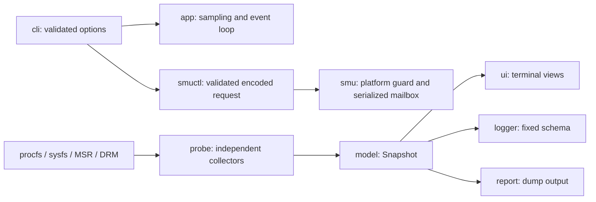

# rustinfo architecture

The existing `tui`, `dump`, `log`, `smu-probe`, `smu-table`, and `smuctl`
commands remain the entry points. The application is still a single Linux binary;
SMU telemetry can additionally use the existing read-only kernel module.

## Sampling

`probe/mod.rs` assembles snapshots; `cpu`, `power`, `io`, `hwmon`, `gpu`,
`system`, and `telemetry` own their sources and parsing. `probe/files.rs` supplies
proc/sys/dev roots so fixtures can exercise collectors without touching control
registers. Missing optional interfaces leave readings absent.

CPU counters are associated with the kernel's logical CPU IDs, including holes
and online/offline changes. Only the first eight `/proc/stat` CPU fields contribute
to total time: guest and guest_nice are already part of user/nice. Short polls
preserve the prior baseline. See the [kernel procfs documentation](https://docs.kernel.org/filesystems/proc.html).

`CounterRate<N>` owns a baseline and cached rate for disk, network, RAPL, and MSR
counters. It samples at windows of at least 50ms, distinguishes monotonic resets
from explicitly configured wraparound, and invalidates a failed read. A missing
counter never becomes a fabricated zero reading. RAPL duplicate interfaces for
one named package are counted once; separate packages are summed for CPU power.
AMD per-core MSRs are deduplicated by thread siblings and labelled by package on
multi-socket hosts.

hwmon discovery is refreshed every ten seconds. It supports power attributes
exposing only `_average`, and converts PWM's 0..255 range to percent. Sensor
attributes retain their kernel filename as identity even if labels are duplicated.
See the [hwmon interface specification](https://docs.kernel.org/hwmon/sysfs-interface.html).
GPU queries use the first detected AMD GPU; multiple-GPU aggregation is outside
the current implementation.

## CSV and terminal lifecycle

A CSV column key is a system field or `(source identity, attribute, unit)`.
The display name is independent: duplicate names receive `#2`, `#3`, etc.
Optional package-power, battery, and VRAM fields have columns from the beginning.
Unavailable readings are blank. Newly discovered devices require a new recording
because a CSV has a fixed rectangular schema.

CSV writes use buffered output and flush each record. Generated names are
created exclusively. Explicit filenames retain overwrite behaviour, but symbolic
links and non-regular files are refused. Root sampling through sudo uses an
unprivileged child writer, running with numeric SUDO_UID/SUDO_GID and no inherited
supplementary groups. It receives length-framed records over stdin and acknowledges
only after writing and flushing each record. The sampling process does not create,
truncate, or chown the destination. A root invocation cannot bypass this through
the private helper mode: that mode refuses to run as root. This closes the old
passwordless-wrapper path to privileged file creation/ownership changes. Direct
root sessions without SUDO_UID retain explicit administrator file access.

The child ignores foreground cancellation signals, finishes on pipe EOF, and is
reaped by its owner; the parent handles SIGINT/SIGTERM and closes its stream after
flushing. Caller-owned directories work as before. Shared directories requiring
supplementary-group membership may require selecting a destination accessible to
the caller's primary group. The helper executable must be traversable/executable
by the caller (as it is in /usr/bin, /usr/local/bin, and their own cargo directory).

The terminal draws immediately, chooses readable column widths, omits per-thread
frequency text when the column is too narrow, and scrolls the sensor list with
PgUp/PgDn/Home/End. CPU temperature history selects CPU sensor sources and excludes
limit readings. A non-TTY invocation returns a normal error with dump/log guidance.

## SMU access

`smuctl::Request` parses and encodes the entire request before any hardware access.
The verified all-core CO encoding stays 28-bit; both `-27` and `0x0FFFFFE5` produce
`0x0FFFFFE5`. A 32-bit sign extension, negative unsigned limits, overflow, invalid
core numbers, and surplus arguments fail before opening the transport. Per-core
encoding is retained as experimental, not represented as confirmed support.

The default CPU guard matches AuthenticAMD/family 0x1A/model 0x24. The host bridge
must also report AMD's PCI vendor ID. The existing RUSTINFO_SMU_FORCE=1 override
bypasses only the CPU guard. Known telemetry decoding additionally requires table
version 0x5D0009.

`smu::Mailbox` groups register addresses; `Reply` and `Status` represent firmware
responses. Full dword writes, bounded polling with a short sleep, and a process
lock serialize cooperating rustinfo userspace transactions. The lock cannot
serialize an external RyzenAdj process or a third-party kernel driver. When the
rustinfo module is present, read-only probe/table commands use its interface first
rather than sending redundant userspace mailbox commands.

Firmware OK is an acknowledgement, and returned arg0 is a mailbox parameter.
Neither is an independent CO state measurement or a stability test. The physical
mailbox constants, verified telemetry offsets, and sparse core-slot map retain
the project's original measurements.

The kernel module keeps its existing read-only operations. Dump reads and buffer
replacement share a mutex; address probes update cached address/value together
only after a successful read. PCI failures are converted to negative errno, dump
ranges are aligned and checked for address overflow, and CPU/host-bridge guards
run before probing. These changes were compiled; no live module reload or tuning
write is needed for the tests below.

## Validation

Rust 1.88 or newer is required, matching the existing locked proc-macro dependencies.
`./scripts/check.sh` runs formatting, Clippy with warnings denied, and all tests.
Unit tests use fixture files and an in-memory mailbox to cover sampling, parsing,
reset/wrap behaviour, duplicate devices, response rejection/timeouts, and tiny
terminal sizes. CLI integration tests invoke the binary, including a child CSV
logger that receives SIGINT; monitoring reads are permitted, control writes are
never issued. Root-only CLI tests also check that a sudo caller cannot create/overwrite root-protected paths, that the private helper cannot run as root, and that output belongs to the caller. Kernel compilation and real read-only dump/render smoke checks are
separate from these tests. Hardware voltage changes and module loading still need
explicit real-machine validation before deployment.
